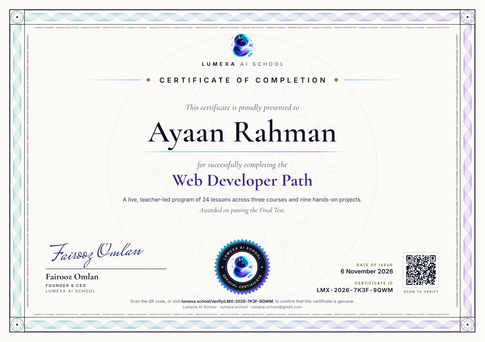
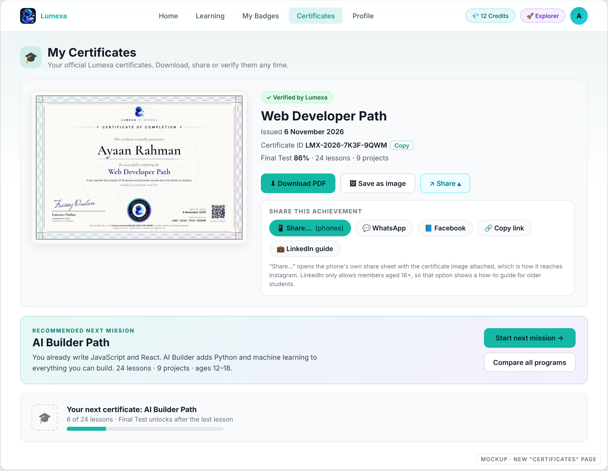

# Lumexa certificates: design, dashboard, e-mail and workflow

*Proposal for the founder's approval. Nothing here is wired into the running app yet. The template, renderer, e-mail and mockups live in [`certificates/`](certificates/) (see its [README](certificates/README.md) for how to run them).*

## 1. Decisions at a glance

| Question | Decision |
|---|---|
| What should it look like? | The template above: ivory A4-landscape paper, navy ink, serif name, a woven "security print" border with microtext, a round seal, the founder's signature, date, ID and a QR code. One design for all seven programs ([contact sheet](certificates/samples/all-programs-contact-sheet.jpg)). |
| What makes it "official"? | Not the decoration. It is a **unique ID + QR + a public verification page**, a stated award rule, a signature and the issuer's name. A PDF alone can always be faked; the page cannot. |
| New "Certificates" item in the navbar? | **Yes.** Add **Certificates** after *My Badges*, show a one-time banner on Home when a certificate arrives, and add a certificate milestone to the Learning page. §5. |
| E-mail | Congratulates the parent ("Dear Parent" is the house style), shows the certificate in the body, attaches the PDF, offers WhatsApp/Facebook sharing and recommends the next program with a mission-themed button: **"Start {Name}'s next mission"**. Copy in §6. |
| HTML first, then PDF? | **Yes, and keep the HTML forever.** The HTML is the template; the PDF and PNG are printed from it for each student. CS50's own certificate is made this way. §7. |
| Biggest improvements | Public verification page; an age-aware next-program rule (the current one has a bug); issuance that cannot fail silently; a name check before issuing. §8. |

## 2. What already exists, and what I found

Lumexa already issues certificates, so this is an upgrade, not a new feature.

- **Trigger:** passing a Final Test (`assessments.service.ts` after the viva, `test-reports.service.ts` on report approval) calls `CertificatesService.checkAndIssueCertificate`.
- **Rules:** one certificate per student per program (`@@unique([studentUserId, courseId])`), ID `LMX-YYYY-XXXXXXXX`.
- **File:** a PDF drawn with pdfkit, uploaded to Cloudinary, link stored in `Certificate.pdfUrl`.
- **E-mail:** to the billing contact (or the student), with the PDF and the next program's curriculum PDF attached.
- **Dashboard:** `CertificatesCard` at the bottom of Home, hidden until a certificate exists.

| # | Finding | Evidence | Why it matters |
|---|---|---|---|
| 1 | The current certificate does not look official. Dark screen-style page, empty lower half, no signature, no QR, no verification. The 🚀 in the heading prints as `Ø=Þ€` because the built-in PDF font has no emoji. | Reproduced from the service's drawing code: [`before-current-certificate.png`](certificates/samples/before-current-certificate.png) | First impression of the credential. |
| 2 | There is no way to verify a certificate. No `/verify` route exists. | Searched `client/app` and `server/src` | "Verified" is currently just a claim. |
| 3 | **The "next program" rule ignores age.** | I ran the real `getNextRecommendedCurriculum` (table below) | The e-mail would tell a 14-year-old Odyssey graduate to enrol in Little Coders (ages 6–11). |
| 4 | Issuance can fail silently. If the Cloudinary upload throws, no certificate is created and nothing retries. | `certificates.service.ts` returns after logging; the only two callers are fire-and-forget; no cron | A student can pass and never receive a certificate. |
| 5 | Dates use the server's time zone, not Dhaka. | `toLocaleDateString('en-US')` with no `timeZone` | A certificate issued after midnight Dhaka time can show yesterday's date. |
| 6 | The e-mail's "Lessons completed X / 28" divides by `course.sessions`, which includes the 4 assessment sessions of the 24-lesson programs. | `course-catalog.seed.ts` | Likely to read as "24 / 28" on a completion e-mail. Check with a real student's data. |
| 7 | The printed name is whatever is in `User.fullName`, with no check and no way to reissue. | Code read | A typo or nickname is printed on a formal document. |
| 8 | The marketing site and the database disagree on ages: Little Coders is "6–9" on the site and 6–11 in the database; Data Scientist is "12–18" vs 13–18. | `client/lib/programs.ts` vs `course-catalog.seed.ts` | The next-program rule needs one source of truth. |

Output of the current recommendation rule (verified by running it):

| Student finished | Rule recommends | That program's ages |
|---|---|---|
| Lumexa Odyssey (12–18) | **Little Coders Path** | 6–11 |
| AI Builder Path (12–18) | **Little Coders Path** | 6–11 |
| Web Developer Path (12–18) | Digital Independence Path | 15–18 (a 12-year-old is not eligible) |
| Little Coders Path | Game Creator Path | 10–18 |

## 3. The certificate template

**What I took from your two samples, and what I left out**

| From CS50 | From Codingal | Deliberately left out |
|---|---|---|
| White paper, generous space, the name as the hero; one specific line about what was done ("including twelve projects"); signer name and title; a QR code and a short verification URL | A visible unique ID and date; a seal for the "official" feel; a signature; a confident program title | Third-party badges and claims ("STEM.org accredited", "built by alumni of Google/Amazon"): only print what is true for Lumexa. Dark backgrounds (ink-heavy, less formal). Emoji and gradient text (do not print reliably). |

**Anatomy**

| Element | Purpose |
|---|---|
| Logo + "LUMEXA AI SCHOOL" | Issuer identity |
| "Certificate of Completion" | Accurate document type. Avoid "Diploma"/"Degree"/"Accredited" unless Lumexa actually is. |
| Student name (serif, auto-fits, wraps at the extreme) | The hero |
| Program name | Indigo, second most important |
| One factual line + "Awarded on passing the Final Test." | Counts come from the database; the criterion must match what the system enforces |
| Optional "with Distinction" | Only when the Final Test score reaches the threshold |
| Founder signature, name, title | Authority. The sample uses a font-made **stand-in** signature. |
| Seal | The "official" mark (decorative, not a security feature) |
| Date of issue (Dhaka time) and Certificate ID | Reference data |
| QR code + printed URL | The actual verification |
| Woven border and microtext | Security-print style. Decorative: it deters casual copying but is not what makes a certificate trustworthy. |

**Fields that change per student** (everything else is fixed): `studentName`, `programName`, `programDescriptor`, `honors` (optional), `issueDate`, `certificateId`, `verifyUrl` (also becomes the QR), plus the founder's name, title and signature image.

**Wording rules.** Say only what the system enforces. Today that is "passed the Final Test". Do not print attendance, hours or skills claims that nothing checks. Do not print age or grade (children's data).

**Checks I ran** (all passing; `npm test` reruns 11 of them):

- **PDF:** one A4-landscape page, 289 KB, fonts embedded, name/ID/date extract as real text, tagged for screen readers, document properties set (title, author, subject). The border, rosette and seal stay vector; only the logo and signature are raster.
- **QR code:** decodes to the verification URL from the PDF rasterized at 72, 100 and 150 dpi, from a deliberately degraded copy (grayscale, blur, JPEG quality 45), from the shared PNG and from the JPG preview. The 1200×630 link-preview card is a thumbnail, not meant to be scanned.
- **Names:** a 2-letter name, a 37-character name (one line), an 82-character name (two lines) and a Bangla name (bundled fallback font, correct conjuncts) all stay inside the frame and clear of the signature row. A certificate issued at 1:10 a.m. Dhaka time correctly shows that day.
- **Contrast:** all text passes WCAG AA (the gold labels failed at 4.3:1 on my first pass; I darkened them to 5.7:1).
- **Black-and-white printing:** reads like an engraved certificate, QR still decodes.
- **Hostile names** (``:

| Protection | Result |
|---|---|
| All on | Name shown as text; nothing runs; no request |
| Escaping off, CSP on | Still blocked by the CSP |
| Escaping and CSP off, request blocking on | **The script ran** and tried to reach `evil.test`; only request blocking stopped the request |

**Immutable by design:** generate once at issue time, store the PDF/PNG, and never regenerate on the fly, so an old certificate can never change when the design does. Store `templateVersion`. A "reissue" (name fix) renders again with the *same* ID and date, logs an audit entry and keeps the old file.

## 8. Workflow improvements, in priority order

**Before the first official certificate**
1. Public verification page, QR, revoked state, rate limiting, `noindex`.
2. A permanent domain for the printed URL.
3. The age-aware next-mission rule (fixes finding 3).
4. Issuance that cannot fail silently: create the row as `PENDING`, render and upload, mark `READY`, e-mail; a cron sweeper retries `PENDING`; an admin "regenerate" button. (`@nestjs/schedule` and `EmailLog` retries are already in the codebase.)
5. A name check: ask once, at about 80% of the program, "Is this how the name should appear on the certificate?", plus an admin reissue with an audit log.
6. Fix the date to Dhaka time and show learning lessons (24), not sessions (28).

**With launch**
7. Certificates page, Home banner, nav dot, Web Share with the PNG.
8. New e-mail; UTM-tag its links so you can count how many certificate e-mails become enrolments.
9. The real signature scan (transparent PNG).
10. Admin certificate tools: list, resend, reissue, revoke.

**Later**
11. A follow-up nudge 7 days later if the "next mission" link was not opened.
12. Instagram-Stories share card (1080×1920) with the name and program.
13. "With Distinction" tier; optional per-program accent colours ("collect all seven").
14. A "skills earned" list on the verify page (from the curriculum).
15. Digitally signed PDFs (a padlock in Acrobat) only if a school ever requires it; it needs a paid certificate from a trusted authority.

## 9. Decisions I need from you

| # | Decision | My default |
|---|---|---|
| 1 | Which **domain** goes on the certificates and QR codes? (permanent) | Buy one; sample shows `lumexa.school` |
| 2 | Send a **scan of the founder's signature** (black pen, white paper, photo is fine) | Sample uses a font stand-in |
| 3 | Is "Lumexa AI School" the legal name? Is there a **registration or trade-licence number** to print? What city if any? | Nothing printed; I did not want to assume a city |
| 4 | What counts as **completed**? Today: passing the Final Test | Keep; if you add an attendance rule, change the printed sentence and the verify page |
| 5 | **"With Distinction"**: on or off, and the threshold | On at 90%; only the top tier is labelled |
| 6 | Verify page: **full name** or "Ayaan R."? | Full name, unguessable ID, `noindex`, policy sentence |
| 7 | Name check: **before** issuing or fix **after** on request? | Ask once at about 80% |
| 8 | Signatories: founder only, or add a second signature? | Founder only |

## 10. If you say go: implementation plan

**Server**
- Prisma migration on `Certificate`: `status` (`PENDING`/`READY`/`REVOKED`), `nameOnCertificate`, `templateVersion`, `pngUrl`, `previewUrl`, `revokedAt`/`revokedReason`, `seenAt`.
- `CertificateRendererService`: `tools/render.mjs` moved in, with `playwright-core` and `qrcode`; template, fonts and images under `server/assets/certificate/`.
- `CertificatesService`: pending-first issuance, retry sweeper, reissue and revoke (audited), age-aware recommender, e-mail with the new fields.
- Public, throttled `GET /certificates/verify/:id`; image endpoints for the e-mail and link previews.

**Client**
- `StudentTopNav` item; `student-dashboard/certificates` page; share helper (Web Share API with fallbacks); public `/verify/[id]` page with Open Graph tags and `noindex`; Home banner; Learning milestone.

**Test checklist:** the 11 self-checks, plus on real devices: WhatsApp and Facebook previews, the phone share sheet, e-mail in Gmail app and Outlook, a printed A4 copy scanned with a phone, and the production host's Chromium memory and timing.

## 11. What is and is not verified

**Verified by running:** the before-render; the recommendation table; all seven programs and the edge-case names; PDF properties; QR decoding at several qualities; hostile-name safety with a negative control; contrast; grayscale; timing and memory; font licences (all SIL OFL); LinkedIn's help page.

**Not verified:** e-mail rendering in Outlook/Gmail; share-sheet and link-preview behaviour on real phones; Chromium on your production host; whether you own the sample domain; the "24 / 28" counting issue against real data; the tablet-width navbar.

**Placeholders in the samples:** the founder's signature is a font-made stand-in; the domain is `lumexa.school`; student names, IDs and dates are invented.
